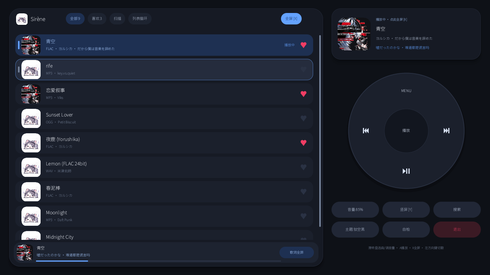

<p align="center">
  
</p>

<h1 align="center">Sirène · 跨平台本地音乐播放器（v1.2.3）</h1>

<p align="center">
  <b>Nintendo Switch（<code>.nro</code>）· Windows · Linux · macOS</b><br/>
  <b>乔布斯 iPod Click Wheel × 现代 Apple 悬浮毛玻璃 × Google Material You 融合设计</b><br/>
  <b>桌面端原生单向竖屏随身听（720×1280 等比缩放窗口 · 拖放即播 · 零配置开箱即用）</b>
</p>

纯软件渲染、无需 GPU，融合乔布斯经典 iPod 转盘骨架、现代 Apple 流体光晕卡片与 Google Material You 色调容器体系，所有切页、切歌、旋转与弹窗均采用轻量丝滑 **60 FPS 淡入动画**。Switch 端支持拆下 Joy-Con 全触屏随身听与专属按键映射；Windows / Linux / macOS 桌面端专注于简洁顺手的**经典竖屏随身听**体验，支持 WAV / MP3 / FLAC / OGG 无损音频与全能内嵌/外挂 `.lrc` 歌词。

## 界面预览

| 桌面 / Switch 竖屏列表页（冰霜白 Apple × M3） | 桌面 / Switch 竖屏播放页（歌词与 Click Wheel） |
| :---: | :---: |
|  |  |

| Switch 横屏双栏（冰霜白 Apple × M3） | Switch 横屏全屏播放（钛空黑 · 流体光晕） |
| :---: | :---: |
|  |  |

| 钛空黑主题 | 青瓷绿 Material You 主题 |
| :---: | :---: |
|  |  |

## 多平台支持（v1.2.3）

| 平台 | 产物文件名 | 渲染与音频后端 | 窗口 / 形态说明 |
|---|---|---|---|
| **Nintendo Switch** | `Sirene.nro` | Switch 帧缓冲 + SDL2 | 横屏/竖屏自动或手动切换，无手柄纯触屏闭环 + 专属按键映射 |
| **Windows x64** | `Sirene-v1.2.3-Windows-x64.exe` | 原生 Win32 GDI + WinMM | 单文件免安装，零外部 DLL 依赖；默认 `468×832` 锁定纵横比竖屏窗口 |
| **Linux x86_64** | `Sirene-v1.2.3-Linux-x86_64.tar.gz` | SDL2 逻辑缩放 + SDL2 Audio | 竖屏窗口（支持 HiDPI / 自由缩放），原生支持 `zenity` / `kdialog` 选目录 |
| **macOS Apple Silicon** | `Sirene-v1.2.3-macOS-arm64.zip` | SDL2 逻辑缩放 + SDL2 Audio | 独立 `.app` 应用包（`Sirène.app`），竖屏随身听形态，原生支持系统文件夹选择器 |

## 核心特性（v1.2.3）

- **多平台竖屏本地播放器（v1.2.3 跨平台）**：
  - Windows / Linux / macOS 统一以 `720×1280` 经典单向竖屏逻辑分辨率运行（自动适配屏幕缩放、保持清晰等比竖屏），内置中文搜索输入框、文件夹选择器与**拖放文件夹/单曲直接播放**。
  - 默认自动扫描用户音乐目录（`~/Music` / `%USERPROFILE%\Music` / 运行目录下的 `music`），也可通过顶部 **`选目录`** 胶囊或拖入任意目录并自动记忆。
- **60 FPS 流畅优化引擎**：
  - 时间驱动 Cubic Ease-Out 淡入动画 + Click Wheel 精灵缓存 + O(R) 抗锯齿圆形/空心阴影光栅 + O(1) 字形哈希表，Switch 与桌面端皆丝滑跟手。
- **法语品牌 `Sirène`（塞壬）与融合设计**：
  - 乔布斯 iPod Click Wheel 转盘（支持点按及顺/逆时针环形滑动选曲/调音量）× 现代 Apple 流体专辑光晕 × Google Material You 动态色调胶囊；内置**冰霜白**、**钛空黑**、**青瓷绿**三套主题。
- **全能歌词与封面引擎**：
  - 支持非正方形封面居中裁切、MP3 ID3v2.3/2.4（含去非同步化）、FLAC `PICTURE`、OGG Base64 封面及同目录 `cover.jpg / folder.jpg`。
  - 支持外挂 `.lrc`（含 `歌名 - 歌手.lrc`、去曲号匹配、模糊匹配、网易云/QQ JSON 转义换行、双语同时间轴合并）与 MP3（`USLT / SYLT / TXXX / COMM / APEv2`）、FLAC/OGG（`LYRICS / LYRICS-XXX`）、WAV 内嵌及二进制兜底扫描。

## 版本归档（独立 Release）

- **v1.2.3（最新 · 多平台竖屏 + 60 FPS 流畅优化版）**：在 60 FPS 轻量光栅引擎基础上新增 **Windows / Linux / macOS 竖屏桌面版**（与 Switch `Sirene.nro` 同置于 `v1.2.3` Release），支持拖放选目录、桌面快捷按键与内建搜歌框。
- **v1.2.2**：`Sirène` 法语命名 + 乔布斯 Click Wheel × 现代 Apple × Material You 融合 UI + 无手柄全触控闭环 + 深度歌词/封面修复 + 专属手柄映射。
- **v1.2.1**：现代 Hi-Res 便携 MP4 双栏版。
- **v1.2.0**：复古乔布斯 iPod Classic 版。
- **v1.1.0**：Material You 初版。

## 安装与使用说明

### 桌面端（Windows / Linux / macOS）
1. 前往 [**Releases v1.2.3 页面**](../../releases/tag/v1.2.3) 下载对应系统的桌面版压缩包或单文件运行即可：
   - **Windows**：直接双击 `Sirene-v1.2.3-Windows-x64.exe`（可传入目录或音频路径作为启动参数）。
   - **Linux**：解压 `Sirene-v1.2.3-Linux-x86_64.tar.gz` 后运行 `./Sirene`（需系统已安装 `libsdl2` 运行库）。
   - **macOS**：解压 `Sirene-v1.2.3-macOS-arm64.zip`，若系统提示未知开发者，可在终端执行 `xattr -cr Sirène.app` 后打开。
2. **添加歌曲**：
   - 将歌曲和 `.lrc` 放入系统 **`音乐 / Music`** 文件夹（或程序旁的 `music/` 目录），启动自动扫描；
   - 点击列表顶栏 **`选目录`**（或按 `O` / `Ctrl+O`）选择任意音乐文件夹（配置自动保存在 `%APPDATA%\Sirene` / `~/.config/sirene` / `~/Library/Application Support/Sirene`）；
   - 或直接将电脑里的**音乐文件夹 / 音频文件拖进播放器窗口**即可切换并开播。

### Nintendo Switch（`.nro`）
1. 从 [**Releases 页面**](../../releases) 下载 `Sirene.nro`（或兼容名 `Siren.nro`），放入 SD 卡 `sdmc:/switch/Sirene.nro`。
2. 音频与 `.lrc` 放入 `sdmc:/music/` 或 SD 卡任意非系统目录。
3. **直接启动**：在 Switch 主菜单按住 **`R` 键打开任意游戏（Title Override）** 进入 hbmenu 启动 **Sirène**。
4. **桌面前端图标**：内置标准 `256×256` 图标与 UTF-8 `Sirène` NACP，可通过机内 **Sphaira -> Install Forwarder** 或电脑端 **SAK / Nro2Nsp + 本机 `prod.keys`** 生成 `.nsp` 转发器安装。

## 操控与快捷键说明

### 桌面端键盘与鼠标
- **鼠标操作**：点击或拖拽界面按钮 / 列表 / 进度条 / 音量滑块；在 **Click Wheel 转盘**上顺/逆时针环形拖动可快速选曲或调音量；鼠标滚轮上下滚动列表或调音量。
- **快捷键**：
  - `↑ / ↓`：移动列表光标 / 全屏调节音量
  - `← / →`：切换上一首 / 下一首
  - `Space / Enter / A`：列表页**就地播放 / 暂停**选中歌曲；全屏页暂停 / 继续
  - `F / X`：淡入进入 / 退出全屏歌词页
  - `Ctrl+F`（macOS `Cmd+F`）/ `S` / `/`：打开内置搜索框（支持中英文输入过滤）
  - `Ctrl+O`（macOS `Cmd+O`）/ `O`：打开系统文件夹选择器更换曲库目录
  - `T`：切换主题（冰霜白 / 钛空黑 / 青瓷绿） · `H`：收藏切换 · `V`：音量面板 · `D`：歌词与系统诊断 · `M / Esc`：返回/退出确认

### Nintendo Switch 手柄专属映射
| 按键 | 列表页 | 全屏播放页 |
|---|---|---|
| **`A`** | **就地播放 / 暂停选中歌曲（不跳进全屏）** | 暂停 / 继续 |
| **`X`** | **淡入进入全屏歌词页** | **淡入返回曲库列表** |
| **`Y`** | **一键切换横屏 / 单向竖屏** | **一键切换横屏 / 单向竖屏** |
| **`左手柄方向键 ← / →`（非摇杆）或 `L / R`** | **切换上一首 / 下一首** | **切换上一首 / 下一首** |
| `↑ / ↓` 或 `左摇杆 ↑ / ↓` | 上下移动选曲光标 | 调节音量（`↑ / ↓`） |
| `左摇杆 ← / →` | —（不误触切歌） | 快退 / 快进 10 秒 |
| `右摇杆 ↑ / ↓` | 调节音量 `− / +` | 调节音量 `− / +` |
| `ZL / ZR` | `ZL` 收藏 · `ZR` 切换主题 | `ZL` 收藏 · `ZR` 切换主题 |
| `− (Minus)` / `B` / `+` | `−` 软键盘搜索 · `B` 退出确认 · `+` 退出 | `−` 搜索 · `B` 返回列表 · `+` 退出 |

## 从源码构建

### 桌面端（Windows / Linux / macOS）
使用仓库内的 [`Makefile.desktop`](Makefile.desktop)：
- **Windows（MinGW-w64 GCC，零额外依赖）**：
  ```bash
  mingw32-make -f Makefile.desktop
  ```
- **Linux（需要 `libsdl2-dev`、`pkg-config`）**：
  ```bash
  make -f Makefile.desktop
  ```
- **macOS（需要 Homebrew `sdl2`、`pkg-config`）**：
  ```bash
  make -f Makefile.desktop macos-app
  ```

### Nintendo Switch（`.nro`）
需要 [devkitPro](https://devkitpro.org/) 工具链（`switch-dev`、`switch-sdl2`）：
```bash
make clean && make
```

## 许可

- 本项目源码：MIT
- 内嵌字体 [Noto Sans SC](https://fonts.google.com/noto)：SIL Open Font License
- 解码与图像单头文件库（`dr_libs`、`stb`）：Public Domain / MIT
