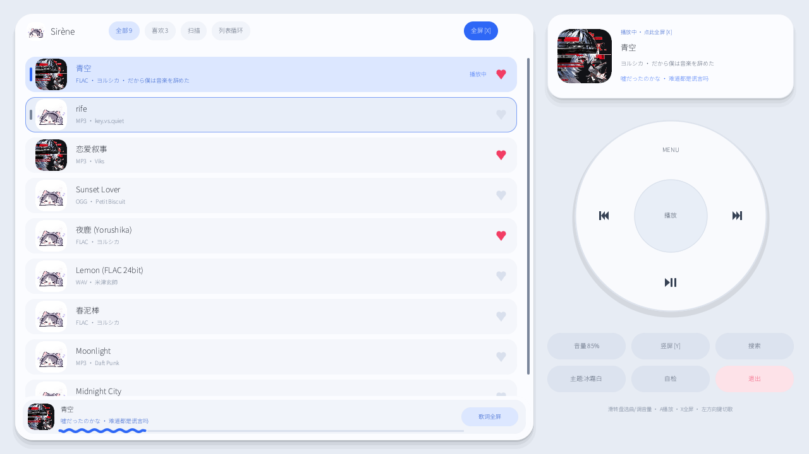
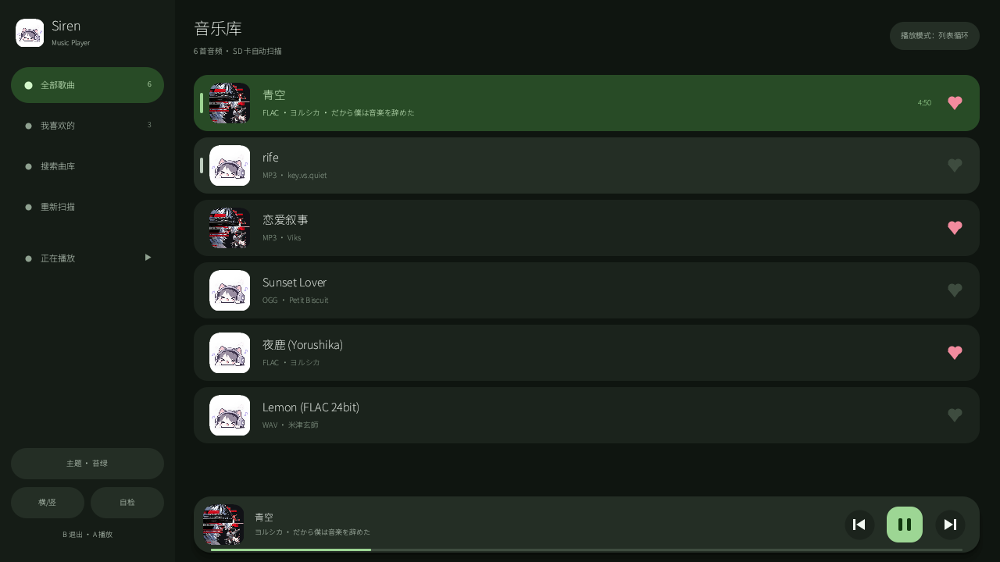

<p align="center">
  
</p>

<h1 align="center">Sirène · 跨平台本地音乐播放器（v1.2.5）</h1>

<p align="center">
  <b>Windows · Linux · macOS（桌面横屏 Material You 专版）&nbsp;|&nbsp;Nintendo Switch（<code>.nro</code>）</b><br/>
  <b>桌面端 1:1 点对点高清横屏双栏 × 大圆角方块按钮 × 全功能鼠标适配 × Material You 粗波浪进度条</b><br/>
  <b>左栏曲库严格裁剪 · 右栏封面与可点击实时歌词 · 原生应用图标（EXE / ICO / App ICNS / Window Icon）</b>
</p>

纯软件渲染、无需 GPU：Switch 端继续保留 **乔布斯 iPod Click Wheel × 现代 Apple × M3** 融合形态与横竖屏无手柄全触控体验；**Windows / Linux / macOS 桌面端则彻底重构为符合 PC 审美的 1:1 高清 1280×720 横屏双栏播放器**——去掉冗大 iPod 圆形转盘，改用 **Material You 大圆角卡片与大方块圆角播控键**、直觉化鼠标悬停/指针/滚动条拖拽/音量直拖/点击歌词跳转，并完整嵌入 `icon.jpg` 系统图标。

## 界面预览

| PC 桌面横屏双栏（1280×720 点对点高清 · 右栏实时歌词） | PC 桌面沉浸全屏歌词（Fluid 光晕 · Material You 粗波浪条） |
| :---: | :---: |
|  |  |

| Switch 横屏双栏（冰霜白 Apple × M3） | Switch 横屏全屏播放（钛空黑 · 流体光晕 + 波浪条） |
| :---: | :---: |
|  |  |

| Switch 竖屏列表（列表视口严格防溢出） | 青瓷绿 Material You 主题 |
| :---: | :---: |
|  |  |

## 多平台支持（v1.2.5）

| 平台 | 产物文件名 | 渲染与音频后端 | 窗口 / 图标与交互亮点 |
|---|---|---|---|
| **Windows x64** | `Sirene-v1.2.5-Windows-x64.exe` | Win32 GDI `1:1`（DPI V2）+ WinMM | 内嵌多尺寸高清 `sirene.ico`（资源管理器/任务栏/标题栏可见）；`1280×720` 点对点锐利渲染 |
| **Linux x86_64** | `Sirene-v1.2.5-Linux-x86_64.tar.gz` | SDL2 + SDL2 Audio | `1280×720` 横屏双栏窗口、`SDL_SetWindowIcon` 窗口图标、原生 `zenity`/`kdialog` 选目录 |
| **macOS Apple Silicon** | `Sirene-v1.2.5-macOS-arm64.zip` | SDL2 + SDL2 Audio | 独立 `Sirène.app`（已内置 SDL2/SDL3 运行库 + `.icns` 桌面图标），支持 `osascript` 选目录 |
| **Nintendo Switch** | `Sirene.nro` | Switch 线性帧缓冲 + SDL2 | 保留横屏/竖屏 Click Wheel 与无手柄触控 + 自定义 A/X/Y/左方向键映射 |

## 核心特性（v1.2.5）

- **PC 专属横屏双栏 Material You 美学**：
  - 彻底移除 PC 端巨大的 iPod 圆形转盘与伪竖屏缩放，采用 **`1280×720` 横屏分栏布局**：左侧 Material You 大圆角曲库卡片（可拖滚动条 + 视口防溢出严格裁剪）+ 右侧专辑光晕大封面与多行实时滚动歌词卡片 + 底部悬浮播控与直接音量条。
  - **1:1 锐利不模糊**：Windows 启用 Per-Monitor DPI v2 感知，在 `1280×720` 窗口下使用 `SetDIBitsToDevice` 零插值点对点直出，文字与封面边缘锐利清晰。
  - **Material You 风格方块圆角与粗波浪进度条**：主播放按钮升级为 Material You 大圆角方块按钮，配合 7px 粗波浪正弦动态进度条与竖向胶囊滑块。
- **全面桌面鼠标适配**：
  - 全界面真实 **Hover 悬停高亮** + 自动切换 **手型指针**；
  - 曲库左侧单击播/停、右侧点击爱心收藏、最右滚动条**点击/按住拖拽翻页**、鼠标滚轮分区响应（曲库翻页 / 音量 bar 调音量 / 进度条快进退）；
  - 右栏歌词支持**鼠标点击任意一行直接跳转该句时间进度**，并支持将音乐文件夹、单曲或 `.lrc` 歌词文件直接拖进窗口。
- **完整系统应用图标**：已将萌猫耳机原画（`icon.jpg`）编译打包进 Windows `.exe`（`.ico`）、macOS `Sirène.app`（`.icns`）、Linux 窗口图标及应用顶栏 Logo。
- **全能歌词与 60 FPS 轻量引擎**：延续高精度时间驱动 Cubic Ease-Out 淡入动画、O(1) 字形哈希表与全能外挂/内嵌歌词解析（含无空格 `歌手-歌名.lrc`、逗号毫秒、非标 UTF-16 `USLT`）。

## 版本归档（独立 Release）

- **v1.2.5（最新 · PC 横屏 Material You 重塑 + 1:1 高清 + 鼠标全适配 + 应用图标）**：专为 PC 重构 `1280×720` 1:1 高清横屏双栏 UI（去掉 iPod 大转盘改用 Material You 大圆角方块按钮与内联音量条）、全量鼠标悬停/指针/拖拽/点击歌词跳转、并内嵌 Windows/macOS/Linux 原生应用图标，统一随 Switch `.nro` 发布于 `v1.2.5`。
- **v1.2.4**：列表严格像素裁剪防溢出 + Material You 粗波浪进度条 + `.lrc` 拖放与解析增强。
- **v1.2.3**：首批 Windows / Linux / macOS 桌面端与 60 FPS 光栅引擎重构。
- **v1.2.2**：`Sirène` 法语命名 + Switch 无手柄全触控闭环 + 歌词/封面深度修复。
- **v1.2.1**：现代 Hi-Res 便携 MP4 双栏版。
- **v1.2.0**：复古乔布斯 iPod Classic 版。
- **v1.1.0**：Material You 初版。

## 安装与使用说明

### 桌面端（Windows / Linux / macOS）
1. 前往 [**Releases v1.2.5 页面**](../../releases/tag/v1.2.5) 下载对应系统安装包：
   - **Windows**：直接双击 `Sirene-v1.2.5-Windows-x64.exe`（可传入目录或曲目作参数）。
   - **Linux**：解压 `Sirene-v1.2.5-Linux-x86_64.tar.gz` 后运行 `./Sirene`（需系统安装 `libsdl2` 运行库）。
   - **macOS**：解压 `Sirene-v1.2.5-macOS-arm64.zip` 打开 `Sirène.app`（如遇未知开发者拦截可执行 `xattr -cr Sirène.app`）。
2. **添加歌曲与鼠标操控**：
   - 自动扫描系统 `Music` 文件夹，也可点击顶栏 **`选目录`**（`Ctrl/Cmd+O`）或将**文件夹 / 音频 / `.lrc` 文件直接拖入窗口**；
   - 点击右侧任意一句歌词立即跳转到对应时间戳；滚动条、粗波浪进度条、右下音量条均支持直接点击或鼠标按住拖动；按 `F` 或点击 `沉浸全屏` 进入全屏大图歌词。

### Nintendo Switch（`.nro`）
1. 下载 `Sirene.nro` 放入 `sdmc:/switch/Sirene.nro`，歌曲与 `.lrc` 放入 `sdmc:/music/`。
2. 在 Switch 主界面按住 **`R` 键打开任意游戏**进入 hbmenu 启动 **Sirène**。

## 从源码构建

### 桌面端（Windows / Linux / macOS）
使用 [`Makefile.desktop`](Makefile.desktop)：
```bash
# Windows (MinGW-w64 + windres)
mingw32-make -f Makefile.desktop

# Linux (libsdl2-dev + pkg-config)
make -f Makefile.desktop

# macOS (Homebrew sdl2 + pkg-config)
make -f Makefile.desktop macos-app
```

### Nintendo Switch（`.nro`）
```bash
make clean && make
```

## 许可

- 本项目源码：MIT
- 内嵌字体 [Noto Sans SC](https://fonts.google.com/noto)：SIL Open Font License
- 解码与图像单头文件库（`dr_libs`、`stb`）：Public Domain / MIT
