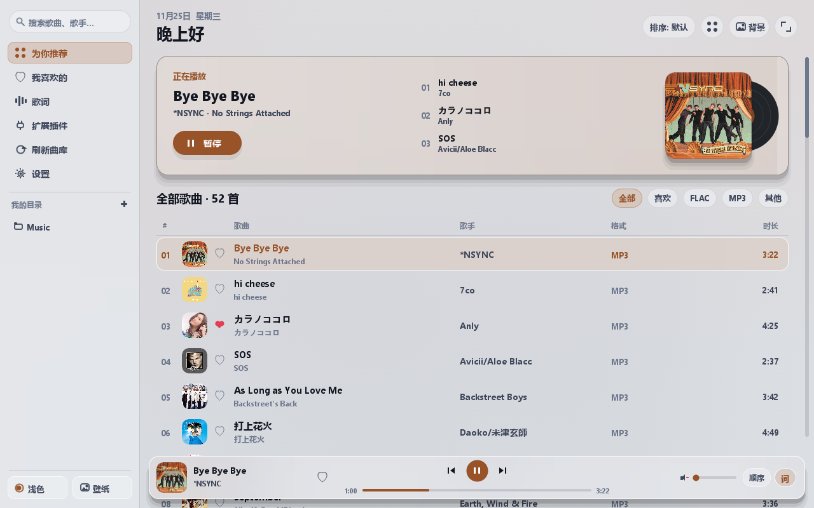
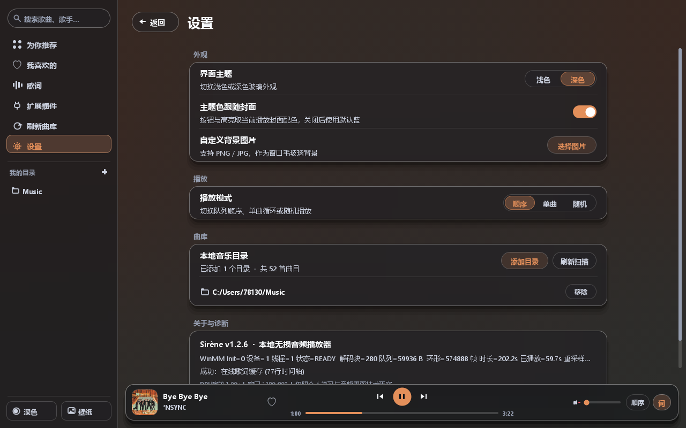
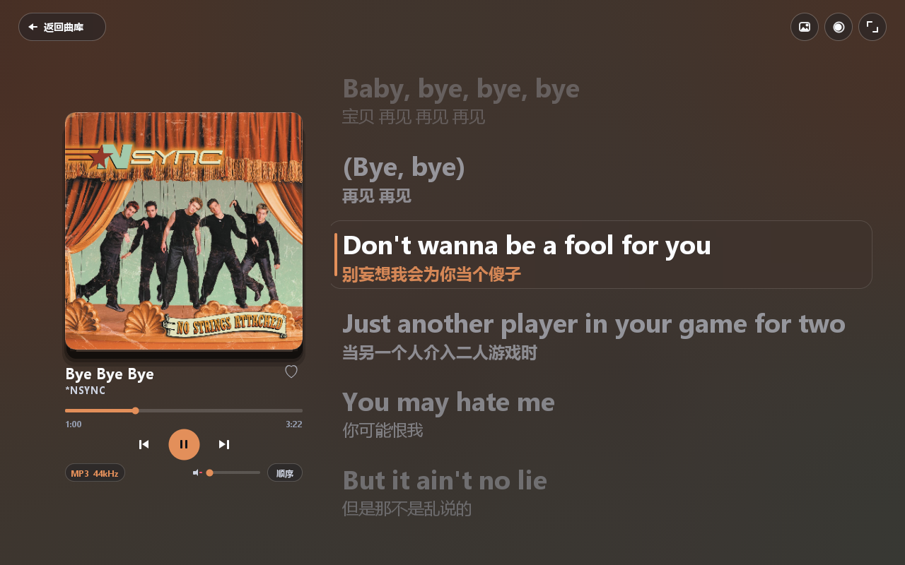

<div align="center">
  

  <h1>Sirène</h1>

  <p>
    <strong>把掌机变成一台现代 Click Wheel 音乐播放器 · Clean-Room Open-Source Homebrew (<code>.nro</code>)</strong>
  </p>

  <p>
    <em>iPod Click Wheel 触控转盘 × Material You 三套主题 × 六轴横竖屏自动旋转 × 双语内嵌/外挂歌词 × 本地无损解码</em>
  </p>

  <p>
    <a href="https://github.com/Leon-Ning-san/SirenMusicPlayer/releases/latest">
      
    </a>
    
    
    
    <a href="LICENSE">
      
    </a>
  </p>

  <p>
    <a href="#界面预览">界面预览</a> ·
    <a href="#核心特性">核心特性</a> ·
    <a href="#后台听歌插件与游戏内浮层">后台听歌插件</a> ·
    <a href="#快速上手-nro">快速上手</a> ·
    <a href="#按键与触控操作">操作指南</a> ·
    <a href="#从源码构建-nro">源码构建</a> ·
    <a href="#桌面端伴生版本">桌面端伴生版</a>
  </p>
</div>

---

> [!NOTE]
> **独立开源与合规声明 / Independent Clean-Room Notice**
> - **Sirène** 是一个纯个人技术研究与开源自制软件项目，基于 `devkitA64`、`libnx`、`dr_libs`、`stb` 等公开开源工具链从零编写，**不包含任何官方闭源 SDK、专有固件代码、密钥或系统绕过/修改机制**。
> - 本项目与任何硬件及游戏机制造商均**无任何官方关联、授权或背书**；软件本身**不内置、不提供、不分发任何受版权保护的音频内容**，仅用于离线播放用户个人合法持有的本地音频文件。完整说明见 [DISCLAIMER.md](DISCLAIMER.md)。

---

## 界面预览

### 竖屏掌机 iPod 模式（720×1280 · 旋转机身或按 `Y` 键一键切换）

| 冰霜白 · 竖屏曲库与触控转盘 | 冰霜白 · 竖屏沉浸歌词与波浪进度条 |
| :---: | :---: |
|  |  |

### 横屏双栏模式（1280×720 · 三套精调主题实时切换）

| 钛空黑 · 沉浸播放与双语歌词 | 青瓷绿 · 曲库与 Click Wheel |
| :---: | :---: |
|  |  |

| 冰霜白 · 横屏默认曲库 |
| :---: |
|  |

---

## 核心特性

- **经典 Click Wheel × 现代 Material You 交互**
  - 完整复刻经典掌上音乐播放器的环形触控转盘：**滑转盘即可顺滑滚动曲库或调节音量**，兼顾单手触屏与实体手柄盲操。
  - 播放状态内置 **Material 3 波浪进度条**（播放时律动起伏，暂停时平滑收直）与淡入淡出转场动画。
- **六轴重力感应自动旋屏 + 一键横竖屏切换**
  - 原生接入六轴姿态传感，竖握机身自动切换为 **720×1280 竖屏 iPod 比例**，横握恢复 **1280×720 双栏布局**；也可随时按 `Y` 键手动锁定/切换。
- **三套手工精调配色主题**
  - 内置 **冰霜白（Frost Silver）**、**钛空黑（Titanium Dark）**、**青瓷绿（Dynamic Sage）**，随时按 `ZR` 或点击按钮无缝切换并持久化保存。
- **纯 CPU 线性帧缓冲直出 · 零着色器卡顿**
  - 使用纯 C 软光栅直接渲染到 `libnx` 线性 RGBA8888 帧缓冲，抗锯齿圆角、封面缩略图与内嵌中日英字体（Noto Sans SC）全本地完成，启动快、功耗低、无外部资源依赖。
- **本地无损解码与多源双语歌词**
  - 纯开源解码后端（`dr_mp3` / `dr_flac` / `dr_wav` / `stb_vorbis` / 自研纯 C AIFF 解码器），支持 **FLAC（含 24-bit）、WAV、AIFF / AIFC、MP3、OGG**。
  - 自动解析内嵌封面、ID3 / FLAC Vorbis 内嵌歌词以及同名外挂 `.lrc` 歌词，支持 UTF-8 / GBK 自动编码识别与双语合并高亮。
- **完整本地曲库管理**
  - 自动扫描 SD 卡音乐目录（上限 8192 首），内置 **红心收藏**、**原生软键盘关键词搜索**、**列表循环 / 单曲循环 / 随机播放** 以及 **一键自检面板**。
- **可选后台听歌插件（`sys-sirene`）+ Tesla 游戏内浮层（`.ovl`）**
  - 安装轻量后台服务模块后，退出 `Sirène.nro` 可一键选择 **「后台继续听 [A]」**，回到桌面或游玩游戏时音乐不中断；再次打开 `Sirène.nro` 自动无缝接回同步歌词与进度。
  - 配合 `SireneOverlay.ovl`（支持 Tesla / Ultrahand 浮层加载器），游戏中随时呼出切歌、暂停、调音量、切循环模式与选曲。

---

## 后台听歌插件与游戏内浮层

想在**桌面或游戏过程中后台听歌**，只需下载 Releases 中的 **`Sirene-v1.2.10-Homebrew-Full.zip`**，直接解压合并到 SD 卡根目录即可（无需手动建目录）：

```text
sdmc:/
├── atmosphere/
│   └── contents/
│       └── 4200000000051234/
│           ├── exefs.nsp        # sys-sirene 极轻量后台音频模块（2 MiB 静态堆）
│           ├── toolbox.json     # 支持在 Toolbox / Ultrahand 中一键开关
│           └── flags/
│               └── boot2.flag   # 开机自启标记（删掉即改为手动启停）
└── switch/
    ├── Sirene/
    │   └── Sirene.nro           # Sirène 主播放器（自动探测并接力后台）
    └── .overlays/
        └── SireneOverlay.ovl    # Tesla / Ultrahand 游戏内快捷浮层
```

- **前后台无缝接力**：重启生效后，在 `Sirène.nro` 播放音乐时按 `B` 或点「退出」，选择 **`后台继续听 [A]`** 即可将当前曲目、精确播放进度、歌单与音量移交后台；下次再进 `Sirène.nro` 会自动接回继续显示双语歌词。
- **游戏内控制**：呼出 Tesla / Ultrahand 浮层（默认 `L + ↓ + 右摇杆按下`）进入 **Sirène**，即可查看进度条、播放/暂停、上一曲/下一曲、`ZL/ZR` 调音量、切换循环模式、选曲或直接扫描 `sdmc:/music`。
- **低内存设计**：`sys-sirene` 采用 2 MiB 静态堆与纯 `libnx` + `audout` 流式解码，空闲/暂停时自动停用音频通道，不占前端显存；未安装后台插件时 `Sirène.nro` 仍可完全独立运行。

---

## 快速上手（`.nro`）

1. 前往 [**Releases 最新版本**](https://github.com/Leon-Ning-san/SirenMusicPlayer/releases/latest) 下载 `Sirene-v1.2.10-Switch.nro`。
2. 将 `.nro` 放入存储卡的开源自制程序目录：
   ```text
   sdmc:/switch/Sirene/Sirene.nro
   ```
   （或直接放在 `sdmc:/switch/Sirene.nro`）
3. 将个人合法持有的本地音频文件（`.flac` / `.mp3` / `.wav` / `.ogg` / `.aiff`）与同名 `.lrc` 歌词放入：
   ```text
   sdmc:/music/
   ```
   > 首次启动也会自动递归扫描存储卡中非系统目录下的音频文件；配置文件与收藏清单保存在 `sdmc:/Sirene/`。
4. 在 Homebrew Menu 中启动 **Sirène** 即可开始聆听。

---

## 按键与触控操作

| 操作方式 | 曲库列表页 | 沉浸播放 / 歌词页 |
| :--- | :--- | :--- |
| **触控转盘滑动** | 顺滑滚动歌曲列表 | 精细调节音量 |
| **十字键 / 摇杆上下** | 上下选择曲目 | — |
| **`A` / 转盘中心** | 播放选中曲目 | 播放 / 暂停 |
| **`L` / `R` 或 `←` / `→`** | 上一曲 / 下一曲 | 上一曲 / 下一曲 |
| **`X` / 顶部按钮** | 进入沉浸歌词页 | 返回曲库列表 |
| **`Y` / 竖屏按钮** | 切换横屏（1280×720）/ 竖屏（720×1280） | 切换横屏 / 竖屏 |
| **`ZR` / 主题按钮** | 循环切换 冰霜白 / 钛空黑 / 青瓷绿 | 循环切换主题 |
| **`-` / 搜索按钮** | 呼出系统软键盘搜索曲库 | 呼出系统软键盘搜索曲库 |
| **`B`** | 打开退出确认弹窗 | 返回曲库列表 |
| **`+`** | 直接退出返回菜单 | 直接退出返回菜单 |

---

## 从源码构建（`.nro`）

依赖纯开源的 [devkitPro `devkitA64`](https://devkitpro.org/) + `libnx` 工具链：

```bash
# 确保已配置 DEVKITPRO 环境变量（或使用 devkitpro/devkita64 容器镜像）
export DEVKITPRO=/opt/devkitpro
export PATH="$DEVKITPRO/tools/bin:$DEVKITPRO/devkitA64/bin:$PATH"

# 1. 主播放器 (.nro)
make clean && make -j$(nproc)

# 2. 后台音频模块 (sys-sirene -> sysmodule/sys-sirene.nsp)
make -C sysmodule clean && make -C sysmodule -j$(nproc)

# 3. 游戏内浮层 (需先将 libtesla 放入 overlay/libs/libtesla)
make -C overlay clean && make -C overlay -j$(nproc)
```

---

## 桌面端伴生版本

除主线 `.nro` 掌机播放器外，本仓库也包含一套基于同一音频与软渲染核心的 **C++17 跨平台桌面伴生版本**（Windows x64 / Linux x86_64 / macOS arm64），方便在电脑端调试 UI、测试解码或日常听歌。

<details>
<summary>展开查看桌面端特性、截图与构建方式</summary>

### 桌面端亮点（v1.2.10）
- **多平台原生物理像素渲染**：Windows（Win32 GDI DPI V2 + WinMM + Media Foundation + 任务栏悬停缩略图播控）、Linux（SDL2 HiDPI + FFmpeg）、macOS（Apple Silicon Retina `Sirène.app` + AudioToolbox）。
- **扩展格式与动效**：支持 MP3 / FLAC / WAV / OGG / AIFF / M4A / AAC / MP4 / ALAC / OPUS / WMA / CAF，内置多层流体封面背景、阻尼弹簧逐句歌词、4 柱频谱均衡与沙盒 Lua 5.4 插件 SDK（见 [docs/PLUGIN_SDK.md](docs/PLUGIN_SDK.md)）。

| 桌面深色曲库 | 桌面浅色列表 |
| :---: | :---: |
|  |  |

| 设置页 | 沉浸歌词页 |
| :---: | :---: |
|  |  |

### 桌面端源码构建
```bash
# Windows (MinGW-w64 g++ C++17)
mingw32-make -f Makefile.desktop

# Linux (g++ C++17 + libsdl2-dev + pkg-config)
make -f Makefile.desktop

# macOS (clang++ C++17 + Homebrew sdl2 + pkg-config)
make -f Makefile.desktop macos-app
```

</details>

---

## 开源许可与致谢

- 本项目源码：[MIT License](LICENSE)（请同时阅读 [DISCLAIMER.md](DISCLAIMER.md)）
- 音频解码与图像处理单头文件库：`dr_mp3` / `dr_flac` / `dr_wav` / `stb_vorbis` / `stb_image`（Public Domain / MIT）
- 开源掌机工具链：`devkitPro` / `devkitA64` / `libnx`
- 内嵌字体：[Noto Sans SC](https://fonts.google.com/noto)（SIL Open Font License）
