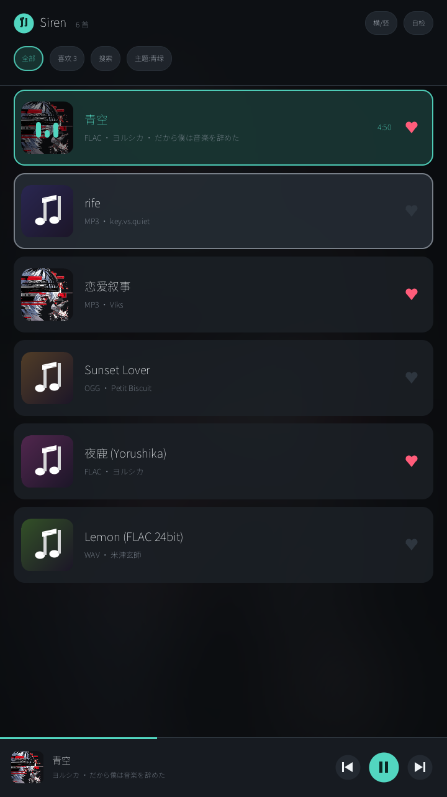

<p align="center">
  
</p>

<h1 align="center">Siren · Switch 本地音乐播放器（v1.2.1）</h1>

<p align="center">
  为破解版 Nintendo Switch（Atmosphère / Hekate）设计的<b>现代 Hi-Res 便携 MP4</b> 本地音乐播放器（<code>.nro</code>）
</p>

纯软件渲染、无需 GPU，采用现代便携随身听（DAP）掌机双栏与竖屏底座交互，兼顾触屏直接操控与完整手柄按键；仅保留页面切换 5 帧轻量淡化过渡，流畅跟手。

## 界面预览

| 横屏双栏（黑金 Hi-Res） | 横屏全屏播放（环境光背景 + 歌词） |
| :---: | :---: |
|  |  |

| 竖屏单向便携 MP4 | 竖屏播放页（实时频谱） |
| :---: | :---: |
|  |  |

| 极蓝主题 | 凝霜白主题 |
| :---: | :---: |
|  |  |

## 核心特性

- **现代便携 MP4 / Hi-Res DAP 布局**：
  - **横屏 (`1280×720`)**：顶部精简胶囊导航条 + 左侧独立播放机芯卡（`244×244` 大封面、实时可拖进度条、播控键、单行实时歌词预览）+ 右侧清爽播放队列，无需复杂侧边栏或复古边框。
  - **竖屏 (`720×1280` 单方向)**：仅保留单一顺时针竖持方向，顶部分段胶囊切换 + 干净歌曲列表 + 底部拇指区便携触控播控底座（进度条 + 播控 + 一键打开全屏歌词）。
  - **三套现代配色**：**黑金 (Obsidian Gold)**、**极蓝 (Arctic Blue)**、**凝霜白 (Glacier Light)**，仅保留 5 帧页面切换淡化，无多余耗性能动画。
- **主流无损与常见音频**：支持 **MP3 / FLAC / WAV / OGG**（SDL2 音频队列输出 + `dr_libs` / `stb_vorbis` 解码），播放页支持专辑模糊环境光背景与 22 段实时频谱条。
- **SD 卡自动扫描与一键重扫**：自动扫描 `sdmc:/music`、`sdmc:/Music`、`sdmc:/音乐`、`sdmc:/歌曲`、`sdmc:/CloudMusic`、`sdmc:/QQMusic`、`sdmc:/Downloads`、`sdmc:/MP3`、`sdmc:/FLAC` 及 SD 卡根目录（自动跳过 `Nintendo` / `emuMMC` / `atmosphere` / `switch` / `RetroArch` 等系统目录），支持顶栏/空列表一键“扫描”。
- **全能歌词支持**：外置 `.lrc`（同目录、`lyrics/` 子目录、`sdmc:/lyrics/`）与 MP3（`USLT` / `SYLT` / `TXXX`）、FLAC/OGG 内嵌歌词，支持 **UTF-8 / UTF-16LE / UTF-16BE / GBK** 与 `[offset:ms]`。
- **完整触控与系统软键盘**：点击歌曲播放、拖动列表滚动、点右侧 `♥` 收藏、拖动进度条、点击 `搜索` 或按 `X` 呼出原生软键盘搜索；设置保存至 `sdmc:/Siren/settings.cfg`，收藏保存至 `sdmc:/Siren/favorites.cfg`。

## 版本选择

- **v1.2.1（最新）**：现代 Hi-Res 便携 MP4 双栏 / 竖屏底座设计（黑金 / 极蓝 / 凝霜白）。
- **v1.2.0**：乔布斯 iPod / Click Wheel 经典转盘版（独立归档于 Releases）。
- **v1.1.0**：Material You 初版风格。

## 安装与启动说明

1. 前往 [**Releases 页面**](../../releases) 下载对应版本的 `Siren.nro`，放入 SD 卡 `sdmc:/switch/Siren.nro`。
2. 音频与 `.lrc` 歌词放入 `sdmc:/music/` 或 SD 卡任意非系统目录。
3. **直接启动（推荐）**：在 Switch 主菜单按住 **`R` 键打开任意游戏（Title Override）** 进入 hbmenu 启动 **Siren**（DBI / Tinfoil / 金叶子只能安装 `.nsp`，无法直接安装 `.nro`）。
4. **如需在 Switch 主菜单桌面显示图标（前端）**：请确保已安装 `sys-patch` 且已导出本机 `prod.keys`，通过机内 **Sphaira -> Install Forwarder** 或电脑端 **SAK / Nro2Nsp** 将 `Siren.nro`（已内置 `256×256` 基准 `4:2:0 JFIF` 猫耳图标）封装为 `.nsp` 转发器后安装。

## 按键说明

| 按键 | 列表页 | 播放页 |
|---|---|---|
| `↑ / ↓` 或 左摇杆 | 上下选择歌曲 | 调节音量 `− / +` |
| `右摇杆 ↑ / ↓` | 调节音量 `− / +` | 调节音量 `− / +` |
| `A` | 播放选中曲目并进全屏歌词（空列表重扫） | 暂停 / 继续 |
| `B` | **退出软件** | 返回列表（音乐继续播放） |
| `X` | 打开 Switch 软键盘搜索 | 收藏 / 取消收藏 |
| `L / R` 或 `← / →` | 上一首 / 下一首 | 上一首 / 下一首（`← / →` 快退/快进 10 秒） |
| `ZL` | 收藏 / 取消收藏选中歌曲 | 切换播放模式（列表循环 / 单曲循环 / 随机） |
| `ZR` | 切换现代配色（黑金 / 极蓝 / 凝霜白） | 切换配色 |
| `Y` | 音频与系统自检面板 | 音频与系统自检面板 |
| `− (Minus)` | 一键切换横屏 / 单向竖屏 | 一键切换横屏 / 单向竖屏 |
| `+ (Plus)` | 退出程序 | 退出程序 |

## 从源码构建

需要 [devkitPro](https://devkitpro.org/) 工具链（`switch-dev`、`switch-sdl2`）：

```bash
make clean && make
```

## 许可

- 本项目源码：MIT
- 内嵌字体 [Noto Sans SC](https://fonts.google.com/noto)：SIL Open Font License
- 解码与图像单头文件库（`dr_libs`、`stb`）：Public Domain / MIT
