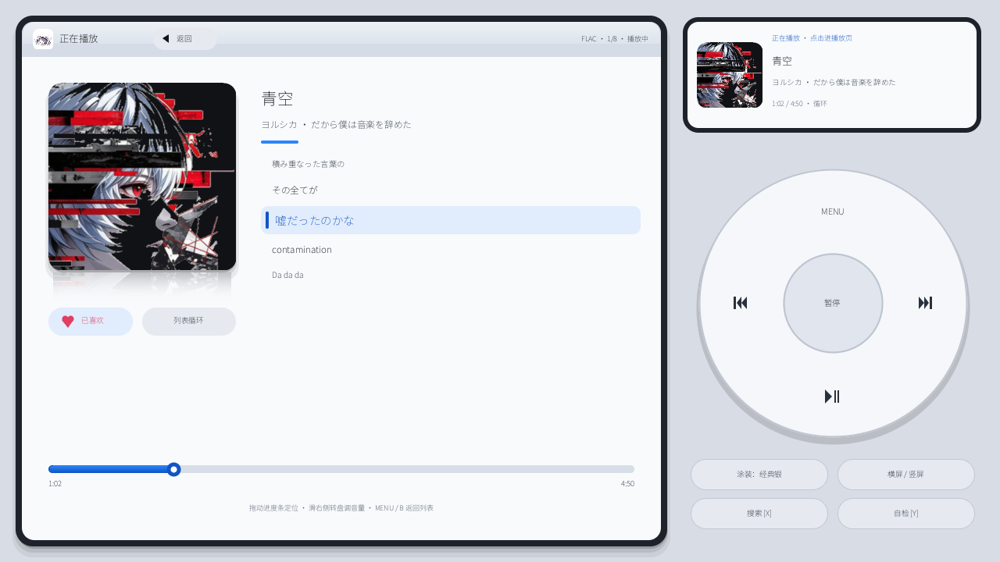
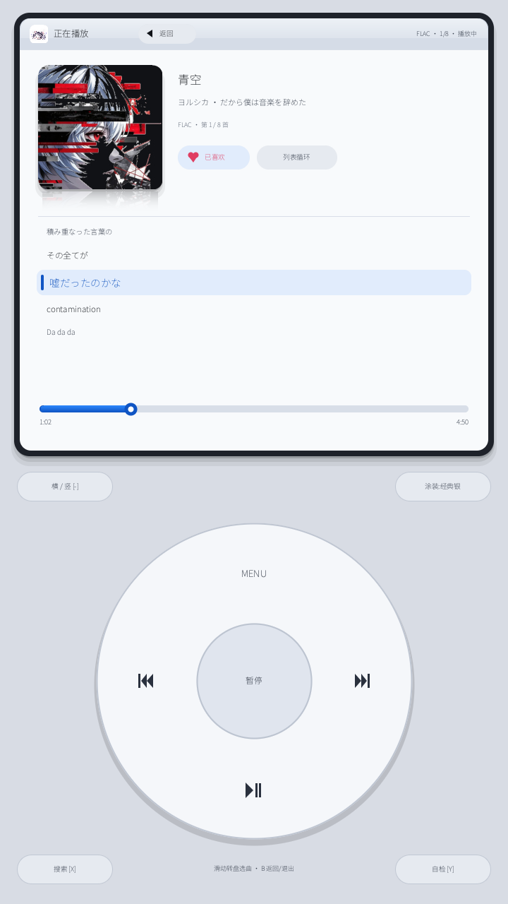

# Siren · Switch 本地音乐播放器（v1.2.0）

为破解版 Nintendo Switch（Atmosphère / Hekate）打造的掌上 MP4 / **iPod 风格**本地音乐播放器（`.nro`）。纯软件渲染、无需 GPU，学习经典 iPod 界面语言：**内嵌玻璃质感 LCD 屏幕 + 可滑动/点按的实体 Click Wheel 转盘 + 封面倒影与歌词显示**，全面适配**触控（含转盘圆周滑动）+ 手柄按键 + 单向竖屏旋转**，保留 5 帧轻量页面淡化过渡。

## 界面预览

| 横屏列表（经典银 iPod） | 横屏播放页（封面倒影 + 歌词） |
| :---: | :---: |
|  |  |

| 竖屏 iPod 列表 | 竖屏 iPod 播放页 |
| :---: | :---: |
|  |  |

| 暗夜黑涂装 | 青碧 MP4 涂装 |
| :---: | :---: |
|  |  |

## 核心特性

- **经典 iPod / 掌上 MP4 交互设计**：
  - **横屏 (`1280×720`)**：左侧玻璃框 LCD 列表/播放屏 + 右侧迷你状态窗、圆形 Click Wheel 转盘与功能按键，告别桌面窗口感。
  - **竖屏 (`720×1280` 单方向)**：仅保留单一顺时针竖持方向，上半屏为经典 iPod 显示屏，下半屏为大尺寸圆形 **Click Wheel 转盘**（支持在圆环上划圈滚动选曲/调音量，点击 `MENU` / `|◀◀` / `▶▶|` / `▶❚❚` 与中心确认键）。
  - **经典银 / 暗夜黑 / 青碧**三套硬件涂装随时切换，仅在列表与播放页切换时保留 5 帧轻量淡化过渡。
- **主流无损与常见音频**：支持 **MP3 / FLAC / WAV / OGG**（SDL2 音频队列输出 + `dr_libs` / `stb_vorbis` 解码），带播放进度拖拽、封面倒影与实时频谱条。
- **SD 卡自动扫描与一键重扫**：自动扫描 `sdmc:/music`、`sdmc:/Music`、`sdmc:/音乐`、`sdmc:/歌曲`、`sdmc:/CloudMusic`、`sdmc:/QQMusic`、`sdmc:/Downloads`、`sdmc:/MP3`、`sdmc:/FLAC` 及 SD 卡根目录（自动跳过 `Nintendo` / `emuMMC` / `atmosphere` / `switch` / `RetroArch` 等系统目录），提供顶部/空列表一键“重新扫描”。
- **全能歌词支持**：外置 `.lrc`（同目录、`lyrics/` 子目录、`sdmc:/lyrics/`）与 MP3（`USLT` / `SYLT` / `TXXX`）、FLAC/OGG 内嵌歌词，支持 **UTF-8 / UTF-16LE / UTF-16BE / GBK** 与 `[offset:ms]`。
- **持久化记忆与系统软键盘**：点击 `搜索` 或按 `X` 呼出原生软键盘搜索；主题、播放模式、音量保存至 `sdmc:/Siren/settings.cfg`，收藏列表保存至 `sdmc:/Siren/favorites.cfg`。

## 安装与前端（桌面图标）说明

1. 前往 [**Releases 页面**](../../releases) 下载 `Siren.nro`，放入 SD 卡 `sdmc:/switch/Siren.nro`。
2. 音频与 `.lrc` 歌词放入 `sdmc:/music/` 或 SD 卡任意非系统目录。
3. 在 Switch 主菜单按住 **`R` 键打开任意游戏（Title Override）** 进入 hbmenu 启动 **Siren**。
4. **如需安装到 Switch 主菜单前端**：`.nro` 无法直接通过 DBI/Tinfoil 安装，可用机内 **Sphaira -> Install Forwarder**（需 `sdmc:/switch/prod.keys`）或电脑 **Nro2Nsp / SAK** 生成转发器 `.nsp` 安装（`Siren.nro` 已内置 `256×256` 基准 `4:2:0 JFIF` 猫耳图标）。

## 触控与手柄操作

- **转盘触控**：直接在 Click Wheel 圆环上**顺/逆时针划圈**即可逐条滚动歌曲（播放页为调节音量）；点击 `MENU` 返回、`◀◀`/`▶▶|` 切歌、`▶❚❚` 暂停、中心圆键确认/暂停。
- **屏幕触控**：点击列表歌曲直接播放，上下拖动列表，右侧 `♥` 快速收藏；播放页支持直接拖动进度条。

| 手柄按键 | 列表页 | 播放页 |
|---|---|---|
| `↑ / ↓` 或 左摇杆 | 上下选择歌曲 | 调节音量 `− / +` |
| `右摇杆 ↑ / ↓` | 调节音量 `− / +` | 调节音量 `− / +` |
| `A` | 播放选中曲目并进入播放页（空列表重扫） | 暂停 / 继续 |
| `B` | **退出软件** | 返回列表（音乐继续播放） |
| `X` | 打开 Switch 软键盘搜索 | 收藏 / 取消收藏 |
| `L / R` 或 `← / →` | 上一首 / 下一首 | 上一首 / 下一首（`← / →` 支持快退/快进 10 秒） |
| `ZL` | 收藏 / 取消收藏选中歌曲 | 切换播放模式（列表循环 / 单曲循环 / 随机） |
| `ZR` | 切换硬件涂装（经典银 / 暗夜黑 / 青碧） | 切换硬件涂装 |
| `Y` | 音频与系统自检面板 | 音频与系统自检面板 |
| `− (Minus)` | 一键切换横屏 / 单向竖屏 | 一键切换横屏 / 单向竖屏 |
| `+ (Plus)` | 退出程序 | 退出程序 |

## 从源码构建

需要 [devkitPro](https://devkitpro.org/) 工具链（`switch-dev`、`switch-sdl2`）：

```bash
make clean && make
```

## 许可

- 本项目源码：MIT
- 内嵌字体 [Noto Sans SC](https://fonts.google.com/noto)：SIL Open Font License
- 解码与图像单头文件库（`dr_libs`、`stb`）：Public Domain / MIT
