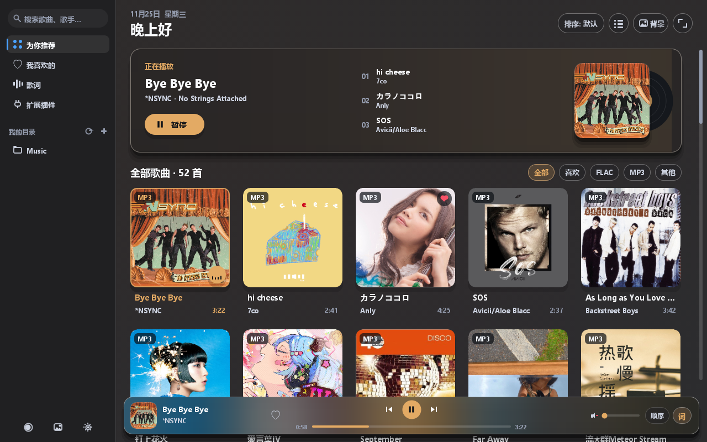

<p align="center">
  
</p>

<h1 align="center">Sirène · 跨平台本地音频播放器（C++17 桌面学习版 v1.2.6）</h1>

<p align="center">
  <b>Windows · Linux · macOS（C++17 原生桌面播放器 × HiDPI 物理像素渲染）· Switch (Homebrew `.nro`)</b><br/>
  <b>半透明毛玻璃层级 × 自定义壁纸背景 × Segoe UI / 雅黑锐利排版 × 本地与在线双语歌词</b><br/>
  <b>支持本地 MP3 / FLAC / WAV / OGG / AIFF / M4A / AAC / MP4 / ALAC / OPUS / WMA / CAF</b>
</p>

> [!IMPORTANT]
> **学习研究与免责声明（使用前请阅读）**
> - 本项目 **Sirène** 为纯个人编程学习与技术研究作品（用于研究跨平台 C++17 桌面开发、音频解码流水线与纯 CPU 软渲染 UI），**非商业用途**。
> - 本项目与任何硬件厂商、游戏机厂商、音乐平台或第三方公司均**无任何官方关联、授权或合作关系**，不包含任何非授权系统修改或绕过机制；任何因下载、编译、分发或运行本项目产生的一切风险与责任均**由使用者自行承担，与原作者无关**。详情请见 [DISCLAIMER.md](DISCLAIMER.md)。
> - 软件本身不内置、不提供、不传播任何受版权保护的音频资源，仅用于播放用户自身合法持有的本地音频文件。

纯软件渲染、无需 GPU：**Windows / Linux / macOS 三个 PC 版本采用 C++17 重构构建**，采用现代桌面音乐播放器布局：**自适应左侧边栏（搜索 / 导航 / 我的目录）× 日期问候页头与渐变精选横幅 × 无框方形专辑封面网格与列表视图 × 底部半透明毛玻璃悬浮播放栏 × 分组毛玻璃设置页**；支持自定义背景壁纸、浅/深色平滑主题过渡、触控惯性滚动优化以及 Windows 任务栏悬停缩略图播控。

## 桌面端界面预览（v1.2.6）

| 深色模式 · 无框封面网格与精选横幅 | 浅色模式 · 曲目列表视图 |
| :---: | :---: |
|  |  |

| 分组毛玻璃设置页（外观 / 播放 / 曲库 / 诊断） | 沉浸式双语歌词页（大字号自动换行） |
| :---: | :---: |
|  |  |

## 支持平台与版本（v1.2.6）

| 平台 | 产物文件名 | 渲染与音频后端 | 交互与特性亮点 |
|---|---|---|---|
| **Windows x64** | `Sirene-v1.2.6-Windows-x64.exe` | C++17 + Win32 GDI 原生物理像素（DPI V2）+ WinMM + Media Foundation | 缩放/全屏/高分屏 1:1 物理像素锐利渲染；`Segoe UI` + `Microsoft YaHei UI` 原生清晰排版；支持触控惯性滚动、桌面快捷方式自动创建、**任务栏悬停缩略图播控栏（上一首 / 播放·暂停 / 下一首）**、UTF-16 拖放、M4A/AAC/MP4/ALAC/OPUS/WMA 解码 |
| **Linux x86_64** | `Sirene-v1.2.6-Linux-x86_64.tar.gz` | C++17 + SDL2 HiDPI + SDL2 Audio + FFmpeg 管道 | 原生 HiDPI 渲染、`SDL_SetWindowIcon` 图标、支持常见有损/无损音频格式 |
| **macOS Apple Silicon** | `Sirene-v1.2.6-macOS-arm64.zip` | C++17 + SDL2 Retina + SDL2 Audio + AudioToolbox | 独立 `Sirène.app`（Retina 物理像素锐利渲染 + CoreAudio 原生解码） |
| **Switch (Homebrew `.nro`)** | `Sirene-v1.2.6-Switch.nro` | C + `libnx` + SDL2 + `dr_libs` | 纯开源自制程序环境运行（无任何官方 SDK）；支持 1080p/720p 渲染、触屏与手柄按键控制、本地无损解码与 `.lrc` 歌词 |

## 核心学习与实现特性（v1.2.6）

- **现代自适应布局 × 半透明毛玻璃视觉**：
  - 宽窗口（`>= 1000px`）自动展开 `220px` 左侧边栏（内嵌搜索框、5 项主导航、「我的目录」快捷管理与底部主题/壁纸开关），窄窗口自动切换为 `76px` 紧凑图标栏；
  - 底部悬浮播放栏采用 `blur(12px)` 半透明毛玻璃与细微边框，封面、播控、进度条与音量条随窗口宽度自适应排布；
  - 支持选择本地 `PNG / JPG` 图片作为窗口毛玻璃背景壁纸，也可随时一键清除。
- **精选横幅 × 无框封面网格 × 流畅触控**：
  - 顶部渐变横幅展示当前曲目、接下来 3 首快捷切歌入口与唱片封面造型；
  - 无框圆角方形封面网格配合封面尺寸缓存与轻阴影，在低功耗触控设备（如 Surface Go 2）上同样保持流畅跟手的触屏滑动体验。
- **分组设置页 × 沉浸式双语歌词**：
  - 独立设置页支持浅/深色主题切换、主题色跟随封面开关、背景壁纸管理、播放模式、曲库目录添加/移除与音频/歌词诊断信息；
  - 沉浸歌词页自动匹配并对齐显示原文与译文（大字号自动换行），支持点击任意歌词行跳转、外部 `.lrc` 拖放与快捷键（`S` 搜索、`V` 视图切换、`C` 浅深主题、`B` 背景壁纸、`D` 设置、`M` 播放模式、`F11` 全屏）。

## 安装与使用（桌面端）

1. 前往 [**Releases v1.2.6 页面**](../../releases/tag/v1.2.6) 下载对应平台包（本工具仅做本地测试与技术学习使用）：
   - **Windows**：双击 `Sirene-v1.2.6-Windows-x64.exe` 即可运行（首次运行自动在桌面生成带图标快捷方式；支持拖入文件夹、音频、`.lrc` 歌词或背景图片）。
   - **Linux**：解压 `Sirene-v1.2.6-Linux-x86_64.tar.gz` 后运行 `./Sirene`（需系统已安装 `libsdl2`，可选 `ffmpeg`）。
   - **macOS**：解压 `Sirene-v1.2.6-macOS-arm64.zip` 打开 `Sirène.app`（如系统拦截可执行 `xattr -cr Sirène.app`）。
2. 自动扫描用户 `Music` 文件夹，也可点击左侧边栏 **`我的目录 +`** 或在 **设置 → 曲库** 中添加/移除任意合法持有的本地音频目录。

## 补充：`.nro` 独立版文件使用说明（开源自制环境）

> *(仅供跨平台学习归档使用；运行环境与合规责任由使用者自行承担，与任何硬件厂商或原作者无关。)*

1. **放置 `.nro` 文件**：从 Releases 下载对应的 `.nro` 文件（如 `Sirene-v1.2.6-Switch.nro`），放入存储卡 `sdmc:/switch/Sirene.nro`（或 `sdmc:/switch/Sirene/Sirene.nro`）。
2. **准备本地音乐与歌词**：将个人合法持有的本地音频文件（支持 MP3 / FLAC / WAV / OGG / AIFF / M4A 等）及同名 `.lrc` 歌词放入 `sdmc:/music/` 目录（程序亦会自动扫描存储卡非系统目录下的音频文件）。
3. **启动与使用**：在开源自制程序菜单（Homebrew Menu）中找到并运行 `Sirène`，即可通过触控或物理按键浏览曲库、搜索歌曲、调节进度并播放本地音乐与外挂/内嵌歌词。

| `.nro` 曲库浏览界面 | `.nro` 播放与歌词界面 |
| :---: | :---: |
|  |  |

## 从源码构建（C++17 桌面端）

使用 [`Makefile.desktop`](Makefile.desktop)：
```bash
# Windows (MinGW-w64 g++ C++17 + windres，静态链接零额外运行库 DLL)
mingw32-make -f Makefile.desktop

# Linux (g++ C++17 + libsdl2-dev + pkg-config)
make -f Makefile.desktop

# macOS (clang++/g++ C++17 + Homebrew sdl2 + pkg-config)
make -f Makefile.desktop macos-app
```

## 许可与开源组件

- 本项目源码（学习研究用途）：[MIT License](LICENSE)（配合 [DISCLAIMER.md](DISCLAIMER.md)）
- 内嵌字体 [Noto Sans SC](https://fonts.google.com/noto)：SIL Open Font License
- 解码与图像单头文件库（`dr_libs`、`stb`）：Public Domain / MIT
